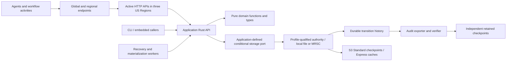
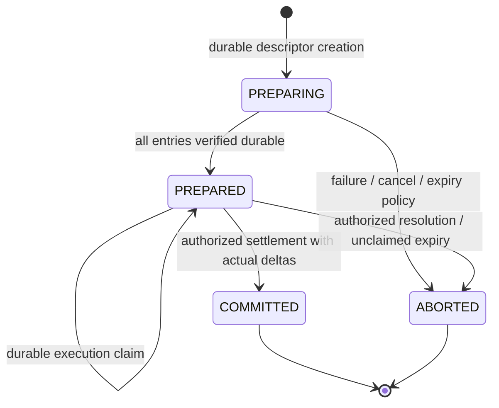

# Rescrow: durable escrow transactions in Rust

Status: proposed distributed/enterprise design. The local snapshot milestone is implemented; see README.md for supported commands and tested limits. No measured performance or enterprise qualification yet.

Date: 2026-11-13.

The first implementation follows [PLAN.md](PLAN.md): a pure Domain, Application/transfer types, and separate CLI invocations over a local file snapshot. It establishes escrow semantics with atomic whole-ledger publication before adding the distributed protocol. Only the local snapshot milestone is currently implemented; the broader mechanisms and acceptance targets below remain proposed.

Deployment spectrum: embedded Rust, concurrent local CLI use, an optional local service, regional APIs, and the enterprise multi-region service. The enterprise profile requires active capacity across three US AWS Regions, synchronously replicated authority, and automatic regional traffic failover. S3 Standard and Express are the first object-storage backends; the reference enterprise authority is DynamoDB multi-Region strong consistency (MRSC).

Design decision: enterprise recovery and security are release requirements for the enterprise profile. Local and regional deployments are first-class uses with explicitly narrower failure domains. A direct S3-only authority cannot meet the enterprise contract. Globally consistent KV authority is a v1 enterprise dependency; local applications must not require that infrastructure or its SDKs.

## 1. Purpose and scope

Rescrow lets applications reserve bounded quantities, perform work that may take seconds or days, and then commit or release the reservation. Examples include inventory, agent spending budgets, API credits, admission capacity, and workflow resource allocation. Independent reservations share a resource without holding an exclusive lock for the life of a transaction.

Rescrow provides a purely functional domain library, an Application Rust API that performs use cases and side effects, and CLI/HTTP entrypoints that invoke that API. The same domain governs concurrent agents on one device and agentic and durable execution workloads in large US enterprises. Storage adapters implement an explicit consistency and durability contract. A transaction domain has one authority, globally consistent in the enterprise profile; projections, caches, backups, and audit copies never become competing authorities.

The design priorities, in order, are:

1. Preserve resource bounds through concurrency, retries, crashes, and ambiguous network outcomes.
2. Make preparation and final decisions durable and independently recoverable.
3. Survive failures within the selected deployment contract; the enterprise profile includes loss of any one Region without losing acknowledged holds, decisions, or duplicate-request protection.
4. Enforce identity and delegated budgets at the deployment's trust boundary, including enterprise tenant isolation and controlled administrative access.
5. Scale hot resources by distributing escrow rights and batching short storage mutations.
6. Make integration predictable for agents and durable execution frameworks.
7. Produce evidence that supports replay, reconciliation, and independent verification.

This is a specialized transaction service for declared additive operations. It does not initially provide arbitrary SQL transactions, arbitrary predicates, general read-modify-write programs, or atomic commit with an external payment, tool invocation, or workflow engine. Financial custody and payment settlement are separate application concerns.

### 1.1 Enterprise acceptance objectives

These are requirements to validate in production-like qualification, not achieved results or inherited cloud-provider SLAs.

| Objective | Required enterprise behavior / initial target |
| --- | --- |
| Regional-loss RPO | Zero lost acknowledged admissions, prepared holds, terminal decisions, policy/configuration activations, and deduplication identities under loss of any one Region. |
| Regional-loss RTO | At most 60 seconds from the first failed synthetic client operation to sustained successful admission and decisions through supported global and regional clients. Measure every drill and the maximum observed interval. |
| Availability | Initial end-to-end monthly SLO of 99.99% for correctly authorized operations with available capacity, with published latency thresholds and error-budget policy. |
| Failure capacity | Sustain the contracted admitted peak after any one Region is lost, without emergency quota increases or provisioning. |
| Security | No cross-tenant access; no unauthenticated mutation; no bypass of required budget ancestors; auditable privileged changes and restore actions. |
| Audit | Accepted transition history has the same regional-loss RPO as live state. Independent archive/checkpoint anchoring target: at most 60 seconds lag; this is a separate evidence-retention objective. |
| Isolation | Faults, overload, and releases are bounded to an enterprise deployment cell; dedicated cells/accounts are available for stronger isolation. |

RTO covers frontends, authority access, authorization, keys, routing, and enough recovery capacity to serve useful work. It does not mean all historical cleanup finishes in 60 seconds. A single-Region loss and a surviving healthy authority quorum are the baseline failure assumptions. Loss of quorum, multiple Regions, credential compromise, and logical corruption have separate procedures and cannot inherit that availability promise. Zero regional-loss RPO does not mean every request with a lost response failed; retries must resolve potentially successful writes.

Measure successful durable preparations and decisions within their latency objectives, rather than treating every `202` as completed work. Report business-capacity rejection, fragmented capacity, authorization denial, and infrastructure failure separately. A timeout with an unresolved outcome is not a business rejection and cannot be excluded by relabeling it.

### 1.2 Enterprise budget semantics

Support declared budgets for currency-denominated cost, tokens, compute time, concurrency, storage, egress, and tool/provider capacity through explicit units and policy. A single request can charge organization, business-unit, project, workflow, and delegated-agent ancestors, across multiple dimensions, in one frozen manifest. The server derives mandatory ancestors from an admitted policy; clients cannot select a cheaper hierarchy or route around shared limits. Depth and participant limits are explicit tenant contract limits and must be qualified against representative enterprise trees.

Distinguish consumable budgets from releasable capacity. Consuming usage commits a negative delta; releasing a concurrency slot requires a separately authorized positive delta linked to the acquisition. Back that credit with bounded refund rights derived once from the acquisition's accepted actual delta, and consume matching refund rights in the release transaction. Permanent release identities handle retries; refund-right conservation also prevents duplicate credits submitted under different keys or through partial releases. Include this lifecycle in the formal model and forbid unrestricted client credits. Windowed quotas use versioned window resources and an explicit rule for work spanning windows; calendar rollover never resets a resource underneath outstanding holds. Replenishments and limit changes are privileged, audited lifecycle operations. Online bound changes and resharding require a reviewed protocol before customers can depend on them.

Reserve a conservative maximum before authorizing work, then settle actual usage. A workflow that needs more must obtain another reservation before additional consumption. If a provider reports usage above the authorized maximum, record a metering violation and reconcile; never silently widen the original hold or erase actual usage. Metering ingestion is independently idempotent. Rescrow can enforce budgets only for actions whose execution gateways honor its authorization receipts; an unmanaged tool or external provider can still incur costs outside that boundary.

### 1.3 Simplicity as a product and engineering value

Pursue simplicity in the sense of Rich Hickey's [Simple Made Easy](https://www.infoq.com/presentations/Simple-Made-Easy/): keep independent concerns from becoming intertwined. Evaluate a design by how clearly its parts and relationships can be understood. Familiarity, small line count, and an additional abstraction do not by themselves establish simplicity.

Prefer a small set of explicit domain concepts, plain values, and direct functions. Add a layer, trait, crate, dependency, service, or configurable mechanism only when it separates an actual concern or satisfies a demonstrated requirement. Explain the coupling it removes and the ongoing cost it introduces. Consolidate or delete superseded mechanisms rather than preserving parallel ways to do the same thing. Elegance of design and implementation is a deliberate goal, including removal of unnecessary machinery during review.

The required Domain → Application → entrypoint boundaries isolate business meaning from effects and presentation. They are responsibilities, not a reason to invent generic repository frameworks, mediator buses, effect interpreters, or a crate for every noun. Backend pluggability, regional resilience, and audit evidence must each have a clear purpose and explicit guarantees. A local user should be able to understand and run the local shape without understanding the enterprise topology.

### 1.4 Deployment shapes and shared semantics

| Shape | Composition | Coordination and durability |
| --- | --- | --- |
| Embedded library | Host invokes Application methods with a selected adapter | Host supplies lifecycle and effect implementations; guarantees follow the adapter. |
| Local CLI | Independent CLI processes invoke the same Application against one local file store | OS locking and conditional atomic snapshot replacement coordinate agents on one machine; durable across the tested restart model. |
| Local service | Optional daemon exposes a local socket or loopback endpoint over that Application | Useful for centralized local authorization and continuous recovery; not required for CLI use. |
| Regional API | HTTP entrypoint and a qualified regional backend | Regional or device failure contract is explicit; no implied multi-region recovery. |
| Enterprise API | Regional HTTP services and globally consistent authority | Full enterprise security, regional-loss RPO zero, and qualified RTO requirements. |
| Deterministic simulation | Application with in-memory fault-injecting adapters | Test/replay use; no durable promise. |

Quantities, reservation rules, decisions, claims, replay identity, and refund conservation mean the same thing in every shape. Coordination, identities, signing, recovery scheduling, and durability are configured at the Application/composition boundary. Capability checks reject a backend that cannot satisfy the requested profile; they do not prohibit legitimate smaller profiles. Local use requires no AWS account, HTTP server, remote identity provider, or cloud dependency in its dependency graph.

Several processes using separate in-memory instances do not share a budget. Concurrent local agents must use the same authoritative local store or service. Every CLI invocation can perform bounded recovery; an explicit recovery operation or optional daemon makes progress while agents are idle. Exiting a CLI cannot erase its durable obligations, and eventual cleanup requires a process to run again.

## 2. Relationship to the original method

Patrick O'Neil's [The Escrow Transactional Method](https://dl.acm.org/doi/10.1145/7239.7265), also available as an [author-hosted PDF](https://www.cs.umb.edu/~poneil/EscrowTM.pdf), describes durable reservations that let long-lived transactions coexist on aggregate fields. Its safety criterion permits any combination of outstanding transactions to commit or abort. Its interface distinguishes the quantity reserved from the quantity ultimately used, and supports recovery before commit.

Rescrow adopts those principles for bounded integer resources. Preparation is durable by default. Clients reserve a maximum change and may commit a smaller change in the same direction. Unlike the paper's broader interface, version one permits only resource-wide fixed bounds and a fixed participant set; it excludes transaction-specific predicates, incremental enlargement, and nested transactions. Distributed rights partitioning, conditional object updates, HTTP integration, and cryptographic audit evidence are engineering choices in this proposal rather than claims about the paper.

## 3. Guarantees and assumptions

| Property | Contract |
| --- | --- |
| Bound safety | Every admissible combination of outstanding reservations and final decisions respects each resource's bounds. |
| Preparation | `PREPARED` means every participant has durably reserved its declared capacity. |
| Decision | Each transaction has one durable terminal outcome, `COMMITTED` or `ABORTED`. |
| Atomicity | All participants interpret one decision. Physical application can lag; no participant may choose a different outcome. |
| Retry behavior | Stable transaction IDs and retained request digests prevent duplicate logical effects. |
| Crash recovery | Any authorized worker can discover unfinished transactions and complete protocol work. |
| Regional recovery | Acknowledged protocol records and their complete dependencies survive any one Region loss in the enterprise profile. |
| Availability | Unavailable storage or an unresolved decision can reduce available capacity. Safety takes precedence over progress. |
| Reads | Transaction status is authoritative. Resource summaries are explicitly sampled views, without a cross-shard snapshot guarantee. |
| Auditability | Durable transition history and signed receipts support verification within a stated trust boundary. |

Every profile assumes that its authority honors strong single-key conditions and its declared durability. Local qualification covers concurrent processes, process termination, interrupted writes, and restart; local disk does not promise survival of device loss. Enterprise qualification additionally covers concurrent servers across Regions, complete loss or isolation of one Region, arbitrary message delay, duplicated requests, clock skew, storage throttling, and lost responses. Its authority must honor globally strong conditions and synchronous regional durability. Regional partitions must never turn into two independent authorities. No profile assumes tolerance of a Byzantine authority or a compromised identity with unrestricted state-write privileges. Independent audit storage and checkpoints improve detection, not prevention of every privileged attack.

The service offers atomic escrow updates and invariant preservation, not general serializability for programs that read arbitrary values and then write. Applications must express admission as a reservation, rather than checking a displayed balance before acting.

## 4. Resource and reservation model

### 4.1 Quantities

A resource has immutable metadata:

```text
Resource {
  tenant, resource_id, generation,
  unit, scale,
  lower_bound: L,
  upper_bound: U | unbounded,
  initial_quantity: Q0,
  shard_manifest,
  authorization_policy_ref
}
```

Use checked signed 128-bit arithmetic in Rust and canonical decimal strings in JSON. No floating-point quantities or implicit unit conversion. Bound intermediate sums and reject overflow before writing. Unit and scale are immutable; changing them requires a new resource generation and an explicit migration.

A client operation is a signed maximum delta `d`: negative consumes existing quantity; positive consumes room beneath the upper bound. A successful commit selects actual delta `a` with the same sign and `|a| <= |d|`. Omitting actual deltas commits the full reservation; specifying them requires one entry for every declared operation, with zero explicitly releasing an unused reservation. A transaction's operation list and routing are frozen when it is created.

The initial public API requires unique operation IDs and at most one operation per resource. When an operation spans cells, allocate actual usage in the manifest's stable cell order, up to each cell's reserved share, until the selected total is reached. Persist that exact allocation in the commit decision. Internal rebalances use a separate validated command with two distinct cells and cannot use partial consumption.

### 4.2 Safety on one shard

Let `b` be the shard's materialized quantity. For entries whose final effects have not yet been materialized, maintain:

```text
D = sum of absolute maximum negative deltas
I = sum of maximum positive deltas
minimum_possible = b - D
maximum_possible = b + I
```

Require `minimum_possible >= 0` and, for finite shard capacity `c`, `maximum_possible <= c`.

A negative reservation of magnitude `x` requires `b - D >= x`. A positive reservation requires `c - b - I >= x`. Pending credits cannot fund another transaction's debit; pending debits cannot create usable upward room. Both may abort. Entries remain conservatively reserved after a decision until materialization releases their capacity.

On commit, atomically add actual delta `a` to `b` and remove the reservation. On abort, atomically remove the reservation without changing `b`. These transformations preserve both inequalities for every remaining entry. They also permit partial use without exposing unused capacity prematurely.

For example, with bounds `[0, 100]`, quantity `60`, a pending debit of `40`, and a pending credit of `30`, the possible interval is `[20, 90]`. A new debit of `25` fails; a credit of `10` fits. The pending credit does not make the debit safe.

### 4.3 Partitioning a hot resource

Represent a finite resource as:

```text
Q = L + sum(b_s)
0 <= b_s <= c_s
sum(c_s) = U - L
```

Each shard independently enforces the preceding reservation rules. Summing those rules proves the resource bounds. For a lower-bounded resource without a finite upper bound, omit each shard's upper check; enforce the implementation's numeric limits regardless.

At initialization, choose `b_s` whose sum is `Q0 - L`, and capacities whose sum is `U - L`. Shard identifiers and capacities are fixed in the first release. No server owns an exclusive right to a shard: rights live in durable shard state and every mutation uses CAS.

Routing uses cached capacity hints, stable hashing, and bounded alternate-shard probing. Large requests can span several shards, subject to a participant limit. The chosen split is persisted in the transaction manifest before preparation. A retry never silently changes that split.

Partitioning can strand capacity. A request may fail even when aggregate capacity would suffice. Return `capacity_unavailable` with a reason such as `fragmented_or_reserved`; a failed sampled search is not proof of global exhaustion.

An internal rebalance transfers materialized quantity between shards through the same transaction protocol: `-x` on a donor and `+x` on a recipient, with an enforced zero net effect and full use of both legs. This relocates downward rights and upward room without changing the resource quantity. It cannot move quantity into a full shard or move rights already held by another transaction. Moving shard capacities, changing bounds, and online resharding require a separate protocol and are deferred.

## 5. Architecture



This is a runtime call graph. The Application owns its storage interface; outer adapters implement it and are injected by a composition root. Compile-time dependencies point inward as specified in section 11. Enterprise services supply the regional routing shown here; local compositions omit it.

API servers are replaceable. Process-local actors coalesce mutations to a shard, but do not establish correctness or exclusive ownership. A stale actor loses its conditional write and reloads state. Recovery workers use the same Application methods and domain transitions as foreground requests.

There is no service-wide transaction sequence, shared decision key, or global application leader on the request path. The underlying authority coordinates writes across Regions. Transaction IDs distribute decision objects; resource shards distribute participant updates. Tenant admission limits and bounded queues prevent one hot resource from consuming all execution capacity.

### 5.1 Deployment cells and control-plane independence

A deployment cell contains independently provisioned regional APIs, recovery workers, authority tables, keys, limits, and telemetry for a bounded tenant set. A large enterprise can occupy several dedicated cells. A resource and all ancestors required for one transaction must reside in the same transaction domain; cross-cell operations cannot claim atomic escrow preparation. Partition enterprise domains around workloads and authority capacity rather than an arbitrary geographic split of the same budget.

An enterprise-wide ceiling spanning several domains requires conserved suballocations, not independent copies of its parent budget. A parent-domain allocation transaction commits a debit before a named child domain can publish the corresponding endowment. Bind the grant to exactly one destination, immutable grant ID, quantity/unit, and generation, and publish it there at most once. Until that publication completes, the allocation is unavailable rather than spendable twice. Return unused allocation only after the child durably retires the returned rights and outstanding reservations are accounted for; a permanent return identity permits one parent credit. Grants remain allocated across child failure and cannot be reclaimed merely because a child is unreachable.

Local transactions then charge local ancestors backed by those grants. This removes the global parent from every child request while conserving its ceiling. Reporting distinguishes unallocated, delegated, reserved, and consumed amounts rather than calling a parent allocation immediate external consumption. Model issuance, publication, returns, replay, and child loss before enabling cross-domain delegation. It is required qualification for enterprises that need several domains under one ceiling, not an implicit cross-store transaction. Without it, keep the shared ceiling and its consumers in one sufficiently provisioned domain.

Run service instances across multiple AZs in each of three Regions. A reference US topology is `us-east-1`, `us-east-2`, and `us-west-2`, subject to service availability and enterprise residency approval. Provision three full authority replicas rather than a witness-only third location so every Region has a read/write service destination. APIs accept traffic in all Regions; prefer one Region for a hot shard to reduce conflicts, with that preference carrying no exclusive-write authority.

Keep the tenant directory, trust roots, admitted policy versions, resource-generation manifests, namespace/HMAC configuration, and active schema compatibility information recoverable through the same regional-loss contract. Deploy immutable signed bundles into each Region and verify their authoritative activation before use. Existing tenants must continue admitting and settling work when account provisioning, human SSO configuration, billing, or the central deployment pipeline is unavailable. Do not require the failed Region to mint tokens, decrypt a manifest, sign a receipt, resolve a directory entry, or approve failover.

### 5.2 Authority, objects, and cache placement

The enterprise authority stores complete bounded cell and transaction records, recovery tickets, active configuration, and the immutable transition records needed to interpret every accepted head. A globally durable head that points to its only history or participant payload in a failed Region is insufficient. Chunk larger immutable records within the authority and verify their complete publication before referencing them; initial record limits should avoid chunking on the hot path.

S3 Standard stores exportable checkpoints and independently retained evidence. Express may hold rebuildable working sets and regional projections. An S3 projection can accelerate inspection or restore, but reads used for admission and decisions always validate against the authority. Losing every regional cache must affect latency and cost rather than correctness or regional-loss RPO. This is an explicit revision to the earlier S3-only authority assumption, not synchronous replication supplied by a regional bucket.

## 6. Storage contract

### 6.1 Required semantics

Every adapter must provide:

1. Globally strong reads of a single key in the enterprise profile, including a dependable distinction between absent and unreadable.
2. Atomic create-if-absent.
3. Atomic replace-if-version-matches against an opaque version token.
4. Whole-value atomicity and durable acknowledgement surviving any one Region loss in the enterprise profile, for heads and every referenced dependency.
5. A discovery mechanism that eventually enumerates unfinished transactions despite concurrent changes.

The first four are on the safety path. Enumeration schedules recovery; it never decides whether a transaction committed. Notifications and derived indexes are accelerators, not authorities.

Capabilities must explicitly report consistency scope, durability/failure domain, supported Regions, maximum encoded record size, and behavior under a regional partition. A regional implementation of this interface is insufficient for enterprise admission even if its method names match. Independent writes to three buckets are not a substitute for a globally ordered conditional-write protocol.

An illustrative Rust boundary, defined by the Application and implemented by outer adapters, is:

The first file-backed milestone instead uses the narrower whole-ledger snapshot port in [PLAN.md](PLAN.md). Its atomic multi-resource publication does not implement the separate-key protocol below. Introduce the broader interface when independent participant publication is actually needed.

```rust
// Sketch: concrete async/object-safety and buffer types are implementation choices.
trait ConditionalStore {
    async fn read_strong(&self, key: &Key)
        -> Result<Option<VersionedValue>, StoreError>;
    async fn create(&self, key: &Key, value: &[u8])
        -> Result<WriteOutcome, StoreError>;
    async fn replace(&self, key: &Key, expected: &VersionToken, value: &[u8])
        -> Result<WriteOutcome, StoreError>;
    async fn scan_page(&self, partition: &Partition, cursor: Option<&Cursor>)
        -> Result<Page, StoreError>;
    fn capabilities(&self) -> StoreCapabilities;
}

enum WriteOutcome {
    Applied(VersionToken),
    ConditionFailed,
    Unknown, // May have persisted. Read and reconcile; never assume failure.
}
```

Errors distinguish throttling, authorization failure, corruption, unavailability, and an ambiguous write outcome. Generic SDK retries must not hide uncertainty or convert it into an unconditional overwrite. A repeated conditional write may fail because its first attempt succeeded.

Values contain a monotonically increasing logical revision and a fresh transition identifier, so revisiting the same business balance does not recreate an old serialized value. Treat backend versions as opaque; never interpret an ETag as an application checksum. Live keys are never deleted and recreated. Terminal IDs remain reserved permanently in the initial implementation.

### 6.2 Durable records

```text
resources/{tenant}/{resource}/{generation}/head
cells/{distribution}/{tenant}/{resource}/{generation}/{shard}/head
transactions/{distribution}/{tenant}/{transaction}/head
work/{distribution}/{tenant}/{transaction}/ticket
history/{distribution}/{content_hash}
```

The resource head publishes immutable bounds, capacities, and shard addresses. Initialization creates an `INITIALIZING` resource, creates every deterministic shard, verifies the full manifest, and then CAS-publishes `ACTIVE`. Reservations require `ACTIVE`; incomplete initialization is recoverable and cannot expose partial initial stock.

A cell head includes revision, resource generation, materialized quantity, capacity, pending entries indexed by transaction ID, and a history pointer. Each entry binds the transaction, manifest hash, reserved maximum, and operation identifiers. Cached totals must be recomputable from entries and validated during replay.

A transaction head contains the immutable request digest and full participant manifest, policy identity, deadline policy, state, and, on commit, actual deltas. Preparation evidence binds each participant entry to that manifest. Finalization acknowledgements may advance monotonically without changing a terminal outcome. A terminal decision's identity is its decision transition hash, not the latest housekeeping revision.

For execution-backed budgets it also contains an optional durable execution claim: action identity, trusted claimant, allowed settlement policy, and claim transition hash. The marker is monotonic and does not change reserved quantities. Expiration and abort predicates must account for it.

Cap cell size, pending entry count, participant count, descriptor size, and complete encoded history-record size. Begin evaluation with a 256 KiB ceiling for each complete encoded authority record, including its metadata, and at most 64 participants per transaction; these are proposed service limits, not backend guarantees. Reject admission before a value exceeds the adapter's maximum. Many long-lived tiny reservations can fill a cell even while quantity remains available. Smaller cells may be essential to keep replicated write cost and hot-key capacity practical.

### 6.3 S3 object and regional adapters

S3 provides strong object reads and atomic updates to a key within its bucket authority; it does not provide an atomic update across keys or a globally ordered CAS across regional buckets. The direct S3 adapter is useful for protocol development and explicitly regional deployments. It cannot serve the enterprise authority by itself. See the [S3 consistency model](https://docs.aws.amazon.com/AmazonS3/latest/userguide/Welcome.html#ConsistencyModel).

Use `PutObject` with `If-None-Match: *` for creation and `If-Match: <ETag>` for replacement. AWS documents these conditional writes for both general purpose and directory buckets. Handle `412` as a failed condition and reconcile conflicting or ambiguous writes with fresh reads before retrying. Use small whole-object writes, explicit transport checksums, and no append or multipart dependency. See [conditional writes](https://docs.aws.amazon.com/AmazonS3/latest/userguide/conditional-writes.html) and [PutObject](https://docs.aws.amazon.com/AmazonS3/latest/API/API_PutObject.html).

| Aspect | S3 Standard | S3 Express One Zone |
| --- | --- | --- |
| Bucket | General purpose | Directory |
| Failure domain | Regional, across multiple AZs | One chosen AZ |
| Placement | Regional application placement | Prefer compute near the chosen AZ |
| Versioning / Object Lock | Available; configure explicitly | Unsupported |
| Native replication | Available; not synchronous commit | Unsupported |
| Listing | Adapter follows documented general bucket behavior | Do not assume lexicographic ordering |
| Authorization | IAM and bucket policy | Directory-bucket permissions and session handling |

These distinctions follow AWS's [storage class documentation](https://docs.aws.amazon.com/AmazonS3/latest/userguide/storage-class-intro.html) and [directory bucket differences](https://docs.aws.amazon.com/AmazonS3/latest/userguide/s3-express-differences.html). Express is an explicit single-AZ durability choice, including potential loss under a destructive AZ failure. An asynchronous copy to Standard does not upgrade an acknowledged Express transaction to regional durability.

Default to Standard for enterprise checkpoint and audit objects; use Express for disposable regional acceleration. Neither direct regional profile meets the enterprise failover requirement. Do not split live cells into Express and authoritative decisions into Standard and describe the combination as regionally durable: losing participant state can destroy the reservation guarantee.

S3 cross-Region replication remains an archive mechanism. AWS describes [Replication Time Control](https://docs.aws.amazon.com/AmazonS3/latest/userguide/replication-time-control.html) as replicating 99.9% of objects within 15 minutes. That is neither a zero-loss commit boundary nor the required regional RTO. Application-level dual writes without a consensus authority can also leave divergent heads after a partition; successful object copies do not solve that ordering problem.

Use conditional-write enforcement policies on supported general purpose buckets, deny application deletion of live state, and isolate state, history, and audit roles. Verify policy support separately for directory buckets. Versioning assists recovery but is not the concurrency protocol. Object Lock protects retained history versions; it does not enforce valid state-machine transitions.

S3-compatible products require their own conformance results. API similarity alone does not establish the required semantics.

### 6.4 Enterprise authority and additional adapters

**DynamoDB MRSC, v1 reference authority:** AWS documents synchronous replication to another Region before write success, latest-version conditional evaluation, globally strong reads, and zero regional-loss RPO. MRSC uses exactly three Regions and currently does not support transaction APIs. See [global-table semantics](https://docs.aws.amazon.com/amazondynamodb/latest/developerguide/V2globaltables_HowItWorks.html). These properties make it a candidate implementation of the single-key protocol; they do not by themselves establish Rescrow's end-to-end SLO.

Require `ConsistentRead` on authoritative base-table reads, revision-conditional mutations, immutable history items, and partitioned work-ticket discovery. Preserve the common multi-key escrow protocol rather than depending on native multi-item transactions. Treat replicated-write conflicts as retriable conditions with rereads; classify uncertain write outcomes separately. GSIs can schedule discovery but cannot authorize decisions. Verify configured consistency and replica topology at provisioning and admission readiness; ordinary eventually consistent global tables must be rejected. Regional strongly consistent reads on an eventually replicated global table do not repair cross-region conditional-write safety.

Benchmark item size, replicated write units, partition distribution, account quotas, and cross-region latency before sizing a cell. Authority data must contain all information needed during failover; an item may not point to a regional-only S3 payload on the safety path. Native SDK retry behavior requires the same ambiguity tests as S3. A future alternative authority, including a mature quorum-replicated engine with S3 checkpoints, must pass identical partition, membership, and restore tests; implementing a new consensus protocol is not a v1 prerequisite.

**Local disk, first implementation:** use one versioned JSON ledger snapshot and a stable separate OS lock file. Application methods load and validate a snapshot, evaluate pure domain operations, and conditionally publish a replacement against its revision. The adapter holds an exclusive lock while checking the revision and publishing a synchronized temporary file through rename and directory synchronization. Independent CLI invocations share the same store; a daemon is optional. [PLAN.md](PLAN.md) specifies publication, error handling, qualification, and the supported local filesystem scope. Ordinary rename without locking, conditional revision checks, and synchronization is insufficient.

This first local publication boundary atomically updates every affected resource and transaction together. It preserves escrow rules but does not exercise partially prepared participants, separate decision materialization, or the distributed recovery protocol. Add those mechanisms when an adapter actually publishes separate keys. A later SQLite adapter is an option if whole-snapshot rewrites or contention warrant it; no embedded database is needed for the first milestone.

Filesystem permissions define the cooperative same-user trust boundary. Enforcing budgets against an untrusted agent requires denying it direct state writes and placing the Application behind a separately privileged local service with authenticated IPC. Durable local state survives its qualified filesystem/device/process failure model, not loss of its only device. Process-kill tests alone do not qualify survival of arbitrary power loss.

**Other KV stores:** require strong per-key conditions and durable acknowledgements. Eventually consistent replicas or last-writer-wins conflict resolution are insufficient without a stronger coordination layer. A deployment cannot activate an adapter whose capability profile fails the core requirements.

## 7. Transaction protocol

### 7.1 State machine



There is no transition out of a terminal outcome. Partial preparation is not reported as a successful reservation. The service can expose `PREPARING` while recovery is still resolving a request.

### 7.2 Prepare

1. Authenticate and authorize the complete request, validate quantities and limits, and choose a fixed shard split using advisory hints. Persist the admitted policy version and bounded authorization context.
2. Derive the stable transaction ID from a tenant-scoped idempotency namespace and client key, using a versioned server HMAC scheme. Each namespace pins its derivation version; rotating signing keys or creating new namespaces must not change existing transaction IDs. Create the recovery ticket described below before creating the `PREPARING` descriptor. On either collision, require the same canonical client-request digest; otherwise return `idempotency_conflict`. Reuse the persisted manifest and routing, discarding a retry's proposed shard split. The client-request digest excludes server-selected routing. Retain namespace derivation keys or an equivalent permanent mapping.
3. For each participant, read its cell **first**, then strongly read the transaction descriptor. Only a descriptor still in `PREPARING` permits insertion. Validate the frozen manifest and bounds. Insert the pending entry with cell CAS. An identical existing entry is success; a conflicting entry is corruption. A failed or ambiguous CAS requires reconciliation. Every new attempt repeats the cell-then-descriptor read order.
4. Verify every participant entry with strong reads. Entries cannot be removed while the descriptor remains nonterminal. CAS the descriptor from `PREPARING` to `PREPARED`, binding the manifest and verification evidence. If an abort won the race, this CAS fails.
5. Return success only after `PREPARED` is durable. Persist no in-memory-only promise. If capacity or a service limit prevents preparation, decide `ABORTED` and schedule release of any partial holds.

Workers may prepare independent participants concurrently with bounded fanout. Fail rather than indefinitely waiting for capacity while retaining a partial set. Deterministic ordering and randomized retry delays reduce contention; no deadlock-freedom claim depends on optimistic actors being fair.

### 7.3 Commit and abort

Commit requires `PREPARED`, current caller authorization, and actual deltas validated under the admitted settlement policy, including trusted evidence where required. CAS the descriptor to `COMMITTED` with those exact deltas and their digest. That CAS is the logical commit point. An eligible abort CAS competes on the same descriptor; only one decision can win. A claimed execution requires the resolution authority and evidence specified in section 7.5, so ordinary caller cancellation or deadline expiry is insufficient.

Repeated commits with the same actual deltas return the same decision. Different actual deltas conflict. A commit after abort returns `transaction_aborted`; an abort after commit returns `already_committed`. A request cannot erase a durable decision by timing out or disconnecting.

For each participant, a materializer reads the terminal decision, then CAS-applies the actual delta and removes the pending entry in one cell update. Removal after commit is evidence that the materializer already applied the effect; it must never add the delta again. This inference relies on the rule that entries can only be removed under a terminal decision. Abort removes the entry without changing quantity. While application lags, the entry continues reserving the larger, conservative maximum.

Rebalancing requires server validation of its full, zero-sum actual deltas. Ordinary independent quota operations do not imply conservation. The initial public API has no monetary transfer semantics or application-declared conservation groups; those would require explicit validation rules.

### 7.4 Abort fences and delayed preparation

An abort can race with a prepare request that has read `PREPARING` but has not yet written a participant. Looking only for currently present entries during cleanup is insufficient.

After a terminal abort, cleanup must perform a revision-changing CAS on **every declared participant**, even when its entry is absent, before acknowledging that participant as finalized. Combined with the cell-then-descriptor read order, this fences an outstanding prepare CAS based on a pre-abort cell version. A preparation attempt that reads the newer cell must subsequently observe the terminal descriptor and refuse insertion.

If a delayed prepare wins before the cleanup CAS, the cleanup loses its condition, reloads, and removes that entry. Commit finalization also advances the cell revision when removing its prepared entry, fencing stale attempts. No preparation retry may reuse an earlier descriptor observation after refreshing the cell version.

Keep terminal descriptors indefinitely in version one. A missing or unreadable decision never means abort. Future compaction must preserve terminal identity and replay protection and prove that delayed requests cannot resurrect retired entries.

### 7.5 Expiration and long-lived work

Expiration is a durable **abort decision**, not automatic erasure of a reservation. A sweeper reads the descriptor and deadline policy, then competes through CAS for `ABORTED`. Commit may win the race. Once abort wins, capacity becomes reusable only through fenced finalization.

For execution-backed enterprise budgets, automatic expiration applies only to **unclaimed** work. Before an external action, an authorized execution gateway CAS-adds an execution claim while the descriptor is `PREPARED`. This races on the same descriptor as timeout abort. If the abort wins, no claim may succeed and the gateway must not execute. If the claim wins, it durably disables automatic expiry refunds. A lost claim response is resolved by reading the same action identity; it does not authorize a second action.

A claimed transaction remains encumbered until trusted metering or reconciliation commits usage, or an explicitly authorized resolution establishes that no consumption occurred or can still occur. Before a refund, the gateway must durably fence the action against any future dispatch/retry and account for already dispatched destination requests. Cancellation races with dispatch through an authoritative action record; a delayed external request with an unknown outcome is unresolved liability. A previously issued claim receipt cannot remain executable after its liability is refunded. An agent cannot abort a claimed hold or reduce its actual usage merely by asserting failure. Unknown external outcomes retain their maximum liability; workflow death, token expiry, a regional outage, and elapsed wall time do not establish a refund. Gateway deduplication, cancellation fencing, and the destination protocol are required because claiming alone cannot atomically execute an external tool.

The first API uses immutable deadlines and explicitly permits server expiration to race with commit. It does not promise a hard real-time cutoff or use wall time as a fencing token. Clock skew can shorten or lengthen the effective hold; it cannot justify releasing capacity without a terminal decision. Document a maximum expected clock uncertainty and a conservative sweeper grace period operationally.

Clients can request a policy with no automatic expiration, subject to authorization and tenant quotas. This supports recoverable long-lived promises but can strand capacity until an authorized party decides. Once granted, revoking a caller's access does not silently release its hold; a separate authorized administrator or service policy must abort it.

The first release does not advertise XA compatibility. A future external 2PC participant mode would need a persistent coordinator identity, coordinator recovery contract, and a prohibition on unilateral timeout abort after voting prepared.

### 7.6 Recovery and discovery

Before creating a descriptor, create an immutable recovery ticket containing its full proposed manifest, canonical request digest, and admitted authorization context. A ticket collision selects the already persisted manifest. After ticket creation, a crashed foreground operation is durably admitted work: a recovery worker may create the descriptor if it is still absent and then resume preparation. This avoids losing a transaction between creation and registration in an index.

Partition tickets across a configured, enumerable set of hash prefixes. Scan every work partition with pagination and repeated passes; a traversal is not a point-in-time snapshot. A ticket can be removed only after its descriptor is terminal and every participant is durably finalized. If a delayed retry recreates a completed ticket, the permanently retained terminal descriptor makes processing it harmless. Ticket deletion is an optional cleanup operation outside the core conditional-write interface; failure merely leaves extra discovery work. Never discard a ticket solely because its descriptor is absent.

This bounds ordinary recovery discovery by outstanding work rather than all historical transactions. Periodic scans of the retained transaction namespace provide an additional reconciliation check. Backend notifications and queues only reduce scan latency. Record scan coverage and oldest unfinished age. The extra ticket write is part of admission latency and cost.

For `PREPARING`, recovery resumes the frozen preparation or aborts according to policy. For `PREPARED`, it preserves holds and awaits an authorized decision or applicable expiration. For terminal states, it materializes or fences every participant and records completion. A finalization acknowledgement is written only after the corresponding durable cell transition. Losing that acknowledgement causes harmless repeated reconciliation.

| Failure | Required response |
| --- | --- |
| Descriptor created; no participants written | Resume or abort from the manifest. |
| Ticket written; descriptor absent | Create the descriptor from admitted work, then resume or abort under its policy. |
| Some participants prepared | Finish preparation or decide abort and release all declared participants. |
| All prepared; prepared response lost | Read descriptor; verify entries and complete the state transition if needed. |
| Decision write response lost | Strong-read descriptor; do not guess the outcome. |
| Commit durable; process crashes before application | Other workers apply the same decision. |
| Abort races a delayed prepare write | Finalize all participants with the abort fence. |
| Cell updated; completion acknowledgement lost | Reconcile absent entry without reapplying committed delta. |
| Decision unavailable or history corrupt | Preserve capacity, fail affected operations closed, and alert. |

Liveness assumes eventual access to the authoritative store and sufficiently scheduled recovery. A held resource cannot safely become available merely because its owner appears dead.

### 7.7 Regional failover, partitions, and failback

Every admitted recovery ticket, prepared cell entry, terminal decision, history dependency, and deduplication record crosses the enterprise authority's synchronous durability boundary before success. No API can advertise enterprise durability by waiting only for a local write and then starting replication. Pending operations can complete despite a lost response, so clients retry with their original namespace and key in the replacement Region.

Regional API failover changes request routing, not ownership of a regional balance. Surviving APIs read the same authoritative records and continue the same transactions. No promotion of an S3 snapshot, counter reset, new transaction-ID namespace, or blanket expiration of old reservations occurs. A warm replacement can serve new work while background workers reconcile outstanding decisions; a full ledger replay is not on the regional RTO path.

The conditional authority is the write fence: stale versions fail against the global latest version, and an isolated Region cannot acknowledge writes through an independent local authority. All mutation paths, including administration and recovery, must use it. An old frontend that still reaches the healthy authority may safely perform currently authorized operations; routing preference is not an exclusive lease. Any future exclusive shard owner or local log must add an atomically checked authority epoch before it can replace this model. DNS changes, cloud credential revocation, wall-clock leases, or a region-health flag alone are not write fences.

| Failure | Enterprise response |
| --- | --- |
| Complete loss of one Region | Health-based routing and SDK endpoint fallback use surviving preprovisioned APIs; retain all acknowledged holds and decisions. |
| Isolated Region without authority access | Reject or time out mutations; never spend its cached rights. |
| Requests reach several healthy Regions | Global CAS resolves competing mutations; backoff limits conflict amplification. |
| Authority quorum unavailable | Preserve state and stop admission/decisions that cannot be durably resolved. Do not form an emergency second authority. |
| Regional S3 or Express unavailable | Continue authoritative operations; suspend/retry exports and rebuild disposable projections. Apply evidence-lag policy separately. |
| Authorization/key service impaired in one Region | Use independently provisioned regional dependencies and valid signed material; fail closed where required identity or decryption cannot be established. |
| Old Region returns with delayed operations | Reconcile through strong reads and CAS. Do not import its snapshots or overwrite global state. |

Preconfigure global routing and explicit regional endpoints. SDKs must abandon unhealthy connections, use bounded per-attempt deadlines and jitter, and query/retry the same transaction elsewhere without waiting for DNS cache expiry. Exercise both SDK and plain HTTP integrations; a global hostname alone is not an RTO guarantee. Failover is an already authorized operational policy, with durable evidence of routing and dependency health, and does not wait for human approval or resource provisioning.

Failback is a gradual traffic shift after regional dependencies, credentials, code compatibility, and fresh authority reads pass readiness checks. Returning workers rebuild caches from the live authority. Do not bulk copy old heads into service. Replica topology changes and replacement of the authority are controlled maintenance operations with their own fencing and rollback plan, rather than ordinary request failover.

This design chooses consistency during a partition. Escrow could later allocate strictly non-overlapping regional rights for disconnected operation, but such rights cannot be reassigned until the old authority and outstanding usage are durably accounted for. That separate protocol is not needed for v1 and cannot be used to promise full-budget availability in every isolated Region.

## 8. HTTP API and execution integration

### 8.1 Endpoints

All business endpoints use `/v1`; tenant identity comes from authenticated credentials. Path IDs are opaque. Publish an OpenAPI contract with generated examples and conformance fixtures.

IDs, request digests, and idempotency namespaces are global within a transaction domain. Return `serving_region`, `deployment_cell`, `authority_generation`, and `durability_profile` as response metadata; none changes business identity on failover. Enterprise namespaces are pinned to `enterprise-mr` and cannot be silently downgraded to a regional adapter. Clients can require that profile, and receipts bind it.

| Method and path | Behavior |
| --- | --- |
| `PUT /v1/resources/{id}` | Administrative create-only initialization, with a stable request identity. |
| `GET /v1/resources/{id}` | Immutable metadata and explicitly sampled quantity/capacity observations. |
| `POST /v1/transactions` | Create and prepare a fixed set of reservations. |
| `GET /v1/transactions/{id}` | Strong authoritative state, decision, and materialization progress. |
| `POST /v1/transactions/{id}/claim` | Trusted execution gateway binds one action and disables automatic expiry refunds before execution. |
| `POST /v1/transactions/{id}/commit` | Decide commit, optionally with partial actual deltas. |
| `POST /v1/transactions/{id}/abort` | Decide abort. |
| `GET /v1/transactions/{id}/receipt` | Fetch signed prepare, execution-claim, or terminal decision evidence. |
| `GET /v1/events?cursor=...` | Optional durable, at-least-once event feed with replay cursors. |

Example request:

```http
POST /v1/transactions
Authorization: Bearer <workload-token>
Idempotency-Key: order-287-reserve-v1
Content-Type: application/json

{
  "namespace": "checkout-workflow",
  "operations": [
    {"id": "stock", "resource_id": "sku-42", "max_delta": "-3"},
    {"id": "credits", "resource_id": "agent-budget", "max_delta": "-1200"}
  ],
  "expiration": {"mode": "abort_after", "hold_seconds": 3600},
  "context": {"workflow_id": "order-287"}
}
```

```json
{
  "id": "tx_example",
  "state": "PREPARED",
  "request_digest": "sha256:...",
  "expires_at": "2026-11-13T22:00:00Z",
  "expiration_scope": "unclaimed",
  "execution_claim": null,
  "durability_profile": "enterprise-mr",
  "serving_region": "us-east-1",
  "deployment_cell": "enterprise-example-01",
  "authority_generation": "ag_example",
  "decision": null,
  "links": {
    "status": "/v1/transactions/tx_example",
    "commit": "/v1/transactions/tx_example/commit",
    "abort": "/v1/transactions/tx_example/abort",
    "receipt": "/v1/transactions/tx_example/receipt"
  }
}
```

The server resolves a relative hold duration once at creation. A replay compares the original duration in the request digest and returns the original deadline; it does not extend the hold. For execution-backed budgets, `expiration_scope: unclaimed` makes the deadline's effect explicit.

Before dispatch, the authorized gateway claims the prepared transaction:

```http
POST /v1/transactions/tx_example/claim
Authorization: Bearer <execution-gateway-token>
Content-Type: application/json

{
  "action_id": "order-287/tool-call-1",
  "destination_id": "approved-order-tool"
}
```

The server validates the action/destination against the admitted policy and CAS-records the claim. Its durable claim identity, signed receipt, and gateway deduplication accompany execution. A successful claim preserves the hold until authorized settlement; the original unclaimed deadline cannot refund it.

```http
POST /v1/transactions/tx_example/commit
Authorization: Bearer <settlement-token>
Content-Type: application/json

{
  "actual_deltas": [
    {"operation_id": "stock", "delta": "-2"},
    {"operation_id": "credits", "delta": "-900"}
  ]
}
```

The response includes `state: COMMITTED`, actual deltas, the stable decision hash, and `materialization: pending | complete`. A successful decision response never waits for every physical participant update. Eventual capacity reuse may therefore lag commit or abort.

### 8.2 Retry and error contract

Use `201` for a newly prepared transaction, `200` for an authoritative replay or terminal decision, and `202` when a durable descriptor exists but processing remains incomplete. A `202` response includes `Location`, current state, and `Retry-After`; it is not a prepared promise. After a timeout with no usable response, clients retry the identical creation request to recover the transaction ID.

Creation requires an idempotency key. Its scope is tenant plus an authorized stable namespace, rather than a transient process identity. Authorization controls who may use or inspect that namespace. Canonical request digests cover operations, units/generations where applicable, expiration policy, and bounded context. Define normalization precisely, reject duplicate JSON keys, and publish digest test vectors. Auth tokens and transport headers are excluded. Replays recheck current access before returning information.

Commit and abort are naturally idempotent at the transaction ID. Commit additionally binds its actual-delta digest. Do not claim exactly-once delivery of HTTP requests, workflow activities, or notifications.

Return structured problem responses with `type`, `code`, `status`, `detail`, `request_id`, and, when known, `transaction_id` and `retryable`. Use `409` for state or idempotency conflicts and capacity rejection, `422` for invalid operations or service limits, `429` for tenant admission throttling, and `503` for unresolved storage availability. Internal CAS contention is generally retried within a bounded deadline, rather than exposed as an application conflict. Authentication and authorization use `401` and `403` without leaking cross-tenant object existence.

If a request has no confirmed terminal outcome, a transport error must not tell the client it is safe to perform a different transaction. Retrying a business operation under a new key can legitimately reserve twice. Return an existing transaction's ID whenever known. Execution claims are idempotent for the same transaction/action identity; a different action conflicts, and an abort decision prevents claiming.

### 8.3 Resource reads

Expose metadata separately from observations. A summary reports its consistency mode, observation interval, materialized sum, reservation totals, and whether finalization is pending. These fields describe sampled storage state, not a linearizable spendable balance. Do not label a sum of shard reads an exact snapshot, even if each individual read is strong.

Authoritative admission always goes through preparation. A client requiring exact accounting at a cut must use a verified quiescent checkpoint or a later snapshot protocol; an exact online cross-resource snapshot endpoint is deferred.

### 8.4 Durable execution and agents

A workflow activity derives its reservation key from workflow identity and logical operation identity, independent of activity retry count. Persist the returned transaction ID in workflow state. On activity replay, repeat the same request or query the ID; commit and compensating abort calls can also be retried.

Recommended lifecycle: reserve a maximum, durably claim its action through the execution gateway, perform authorized work with destination deduplication, then settle trusted actual usage. An unclaimed hold can be aborted; after claim, refund requires the admitted resolution policy, a durable fence against further execution, and evidence of no remaining consumption liability. If an external side effect already happened, changing the reservation does not undo it. Reconcile actual usage and any application-specific compensating action rather than inferring a refund from workflow failure.

For tools with irreversible effects, choose the ordering and failure policy explicitly. Rescrow cannot atomically pair its decision with a tool's side effect. Use destination idempotency keys, an outbox/receipt protocol, or a coordinator appropriate to that destination. A saga is compensation, not distributed atomic commit.

Execution gateways verify a receipt's tenant, workflow/action identity, allowed resource scope, quantity, expiration policy, and signature. Preventing the same receipt from authorizing an external action twice requires durable action deduplication at that gateway or destination. Persist its action identity across regional failover; checking a signature alone is insufficient. Preserve execution evidence when usage or destination outcomes remain unknown and reconcile them before any refund.

A prepare receipt alone is not an executable spending token for an expiring hold. The gateway verifies a successful claim or equivalent non-expiring execution authorization before dispatch. A claim receipt binds the action and original reservation; it does not assert that the action succeeded. Admission, execution, and settlement permissions can belong to different principals. Untrusted agents cannot self-attest metering or mint refund rights.

Agents receive narrowly scoped credentials limiting resources, operation directions, maximum amounts, outstanding holds, lifetime, and commit authority. An opaque reservation ID is not a bearer credential. Treat all context and model-produced text as untrusted data; neither may change authorization policy or invoke an implicit privileged operation.

Strict cumulative tenant or agent budgets must be represented as escrow resources and included as server-required participants in the same frozen manifest. A per-request token limit or process-local counter cannot enforce a shared spending ceiling. Reserve policy-owned operation identifiers so clients cannot omit, replace, or partially release a required budget leg independently of its governed operation. Define that coupling in the admitted policy and validate it at commit.

Event feeds are optional integration aids. Build them from durable decision history, with per-partition sequence cursors and stable event IDs. They are at least once, may interleave across partitions, and have an explicit retention window; an expired cursor requires resynchronization. Status polling remains sufficient for correctness. Generic outbound webhooks are deferred to avoid adding delivery and destination-security complexity to the core.

## 9. Throughput and latency

### 9.1 Scaling strategy

Shard a hot resource into independent durable rights accounts. Use multiple concurrent API workers, bounded asynchronous I/O, connection reuse, and process-local per-cell queues. Coalesce compatible preparations into one cell CAS and coalesce terminal materializations separately. Every request included in a batch is validated against the batch's sequentially simulated state. Conflicts require rebuilding from a fresh read.

Batching must preserve the read order required by abort fencing: load the cell, then validate each included descriptor, then conditionally write that cell version. Persist the complete batch transition before publishing it. Do not acknowledge any member before durable storage acceptance. A lost batch response is resolved by checking each member's entry and descriptor.

Bound batch delay, queue length, batch bytes, and retry count. Separate admission, terminal decisions, and recovery work so new traffic cannot starve capacity release. Tenant fairness and quotas prevent deliberate reservation hoarding. Hints and caches may improve routing but never admit a reservation without an authoritative conditional update.

Sharding improves throughput by reducing contention, at the cost of fragmentation and more work for large operations. A single cell still serializes its mutations; more concurrent CAS attempts against one key can reduce useful throughput.

### 9.2 Budget the actual authority and storage work

With the audit scheme below, each logical head transition requires an immutable history write followed by a conditional head write. For a successful transaction with `k` participant cells and no batching, the full lifecycle normally uses:

```text
3 descriptor transitions: create, prepared, committed
2k cell transitions: prepare and materialize
approximately 1 + 2 * (3 + 2k) logical authority writes, including the recovery ticket
plus reads, completion acknowledgements, receipts, scans, and retries
```

Thus even a one-participant transaction normally costs about eleven logical writes before housekeeping. For a direct regional S3 adapter these are PUTs; for the enterprise MRSC adapter they are conditionally published items and immutable items, charged by record size and replication. Preparation and commit each include several dependent cross-region write round trips. Do not substitute local Express latency for that end-to-end cost.

An execution claim adds another descriptor transition and history write, normally two additional logical writes, before dispatch. Gateway action deduplication, metering, refund-right creation/consumption, policy fences, and cross-domain grants add their own operations. Include them in workflow-specific throughput and latency results rather than using the minimal counter lifecycle as a claim about complete agent execution.

For one-participant transactions, batches of `b` preparations and `b` finalizations reduce the amortized write estimate toward `7 + 4/b` logical writes per transaction, including tickets. Descriptor updates and tickets remain per transaction in the initial protocol. At 100,000 committed transactions/s, even that optimized floor is roughly 700,000 logical writes/s before other work and replicated capacity-unit amplification. Provisioning and cost must be evaluated at encoded-byte and replicated-storage-request rates, not just API-request rate. Hierarchical budgets add participants and concentrate traffic on shared ancestors; benchmark those trees rather than extrapolating from unrelated counters.

Qualify quotas and provisioned headroom in every Region, table, partition, key service, and network path before accepting a customer peak. AWS documents [DynamoDB throughput quotas](https://docs.aws.amazon.com/amazondynamodb/latest/developerguide/ServiceQuotas.html); an on-demand billing mode is not proof of unlimited immediately available failover capacity. If three Regions normally share traffic evenly, each survivor must support at least half the total peak plus the measured retry and recovery margin after a Region is lost.

AWS's [S3 performance guidance](https://docs.aws.amazon.com/AmazonS3/latest/userguide/optimizing-performance.html) describes scaling with partitioned prefixes. Those figures are not per-object CAS throughput promises. Spread transaction and history keys, measure real contention, warm workloads gradually, and handle throttling with bounded exponential backoff and jitter.

### 9.3 Provisional performance gates

These are engineering targets to test, not product claims:

| Workload | Initial evaluation target |
| --- | --- |
| Enterprise MR, many independent resources | Explore 100k completed one-participant transactions/s per provisioned cell and scale aggregate capacity through independent cells. |
| Enterprise MR, one popular ancestor budget | Explore 10k completed transactions/s across 64–256 rights shards; include descendant charges and quantify fragmentation. |
| Enterprise latency | Initially evaluate prepare p99 at most 1 second and commit p99 at most 500 ms at sustainable contracted load; tighten only after real inter-region measurements. |
| Regional failure | Preserve RPO zero and the 60-second regional RTO while surviving Regions sustain contracted peak, including retries, policy checks, signing, and recovery. |
| S3 profiles and projections | Measure Standard/Express adapter and export behavior separately; regional-only results do not qualify enterprise transactions. |
| Cleanup | No invariant loss; publish time to release capacity after crash and failover at each load level. |

Benchmark both short and long holds, opposing directions, partial use, near-exhausted resources, skew, large transactions, saturated pending-entry limits, and failure/recovery overlap. Report p50/p95/p99, successful decisions/s, abort/rejection rates, storage requests/decision, bytes, retry amplification, audit lag, stranded rights, and cost per million decisions. Include signer and encryption overhead.

If the reference authority misses latency, cost, or hot-budget targets, revisit batching, record sizes, partitioning, and a mature replicated authority implementation. Such a change must preserve the complete multi-region contract; falling back to local disk or regional S3 is not a performance optimization for enterprise namespaces. Regional escrow allocations and replicated-log authorities remain separately reviewed alternatives.

## 10. Security and audit evidence

### 10.1 Trust boundaries

Use TLS, workload identity, current authorization on every API operation, and tenant-scoped resource namespaces. Derive storage keys from validated structured IDs rather than raw path concatenation. Enforce request size, operation count, numeric magnitude, token audience/expiry, and outstanding-capacity limits before expensive storage work. No end user or agent receives direct write access to authoritative storage.

Separate runtime state mutation, recovery, audit export, audit verification, and administrative policy roles. Encrypt at rest with managed keys where appropriate and test key-disable behavior. Denied decryption makes a decision unavailable; it never permits releasing its reservation. Minimize personal data in immutable context because audit retention can outlive application records.

Treat a malicious client, duplicate delivery, and an ordinary server crash as expected failures. A malicious authorized storage writer or compromised signer is a stronger threat: service validation alone cannot prevent it from fabricating state. Independent retention, checkpoints, role separation, and reconciliation limit and expose that damage.

### 10.2 Enterprise identity and delegated authorization

Use a zero-trust model: a private network or a healthy Region does not establish identity or permission. This follows the resource-centered approach in [NIST SP 800-207](https://csrc.nist.gov/pubs/sp/800/207/final); the following are Rescrow requirements, not a certification claim.

Machine calls use short-lived workload credentials with issuer, audience, subject, tenant, environment, and permitted delegation chain. Validate signatures and allowlisted issuers, reject algorithm confusion, and bind high-assurance clients to mTLS or another proof of possession. Service-to-service calls use mutually authenticated workload identities. Humans use enterprise federation and MFA through a separate administrative surface; human directory synchronization never directly authorizes runtime mutations. No shared long-lived API key is the production default.

Authorization combines roles with attributes for tenant, resource subtree, environment, operation direction, quantity, hold duration, required ancestors, and whether the principal may prepare, settle, release, replenish, or administer. Delegation only narrows authority and cannot discard an ancestor budget, change units, or substitute workflow identity. Keep budget enforcement in the deterministic core and required transaction participants rather than only an HTTP gateway. Shared ancestor charges are combined deterministically, with policy-defined actual-use coupling, before the manifest is frozen.

Distribute signed immutable policy bundles and activate versions through the authority. Validate issuer/key rollover and policy freshness independently in every Region. Set and measure a maximum policy-cache age; initially target at most 30 seconds before new admissions stop using a superseded policy. If required freshness cannot be established, refuse new preparation rather than authorize indefinitely from a stale bundle. Already durably admitted work may finish its scoped recovery or settlement obligations; credential revocation does not delete a hold or undo a side effect.

Distinguish denial of new requests from cancellation of admitted commands. A resource/tenant emergency freeze is a durable administrative operation with a documented completion barrier for affected mutations and in-flight admissions. Publish its scope and completion status; do not claim an instantaneous global revocation merely because a separate policy record changed. Any stronger guarantee must include the policy epoch in the same conditional mutation that enforces it and pass delayed-write race tests. Settlement, safe abort, and forensic access have separately authorized incident paths.

Store only the bounded authorization facts required to reconstruct admission: principal and delegation identities, policy version/hash, approved scope, and decision context. Do not persist raw bearer tokens. Recovery workers act as service identities within the original durable promise and current incident restrictions; they do not gain authority to create arbitrary new customer work.

### 10.3 Tenant, network, administrative, and key isolation

| Boundary | Required controls |
| --- | --- |
| Tenant data | Enforced tenant identity in every key and query; negative authorization tests for reads, listings, receipts, events, and administration; no caller-selected tenant override. |
| Deployment cells | Independent service and data-plane roles, authority tables, regional quotas, and keys; dedicated accounts/cells for enterprises requiring a smaller blast radius. |
| Network | Private enterprise ingress option, TLS end to end, restricted administration endpoints, explicit service egress, DDoS protection, and bounded request/connection admission. |
| Runtime | Minimal non-root images, read-only application filesystem, restricted process capabilities, no interactive production shell by default, and no generic fetch/execute feature driven by client context. |
| Privileged changes | Separate approver and executor roles for policy activation, replenishment/limit changes, key administration, restore, and retention changes; two-person approval and immutable change evidence. |
| Emergency access | Time-limited, scoped, strongly authenticated break-glass access with independent alerting and retrospective review; no permission to bypass escrow invariants. |
| Evidence | Separate administration of retained audit objects, access logs, signing trust roots, and the live authority; a runtime role cannot delete its own evidence. |

Rate-limit by tenant, principal, and costly operation; limit pending holds and discovery work as well as request count. Audit whether policy rejected a request, capacity was unavailable, or a dependency failed without disclosing another tenant's quantities. Logs and traces use allowlisted fields and bounded context; secrets, model prompts, and sensitive tool outputs do not belong in immutable transaction metadata by default.

Encrypt authoritative data, checkpoints, history, and transport. Support enterprise-scoped customer-managed keys and document the exact account, Region, administrator, service integration, rotation, and deletion boundaries. Use authenticated encryption and explicit tenant/domain context where the selected integration supports it. Receipt signing keys are distinct from encryption and idempotency-derivation keys; keep private signing material in an approved protected boundary. Retain historical verification keys and signed key-lifecycle evidence for the full receipt retention period.

Provision decryption and signing capability independently in every serving Region and test regional key-service loss, throttling, disabled keys, revoked grants, and rotation during failover. AWS notes that related [multi-Region KMS keys have independent policies and regional grants](https://docs.aws.amazon.com/kms/latest/developerguide/multi-region-keys-auth.html); key replication alone does not replicate an authorization configuration. Do not assume an AWS service treats related keys as interchangeable without verifying that integration. Customer key disablement intentionally affects availability; denied decrypt/sign operations cannot trigger silent use of a weaker key or durability profile.

Receipt generation must report its actual signing profile. Where an enterprise requires validated cryptography, qualify the specific cryptographic modules, deployment mode, and key boundary; a Rust implementation or TLS library name is not evidence of validation. A signing outage cannot erase a durable commit: return/query the authoritative decision and expose pending receipt availability under the contracted policy. Execution gateways requiring signed evidence wait for that evidence before performing new work.

### 10.4 Secure delivery and assurance

Require reviewed and signed production artifacts, pinned dependencies/toolchains, an SBOM, vulnerability triage, provenance verification at deployment, and isolated build credentials. Use the [SLSA specification](https://slsa.dev/spec/v1.2/) to define and assess build-provenance controls. Fuzz parsers and canonicalization, bound allocations and decompression, and review unsafe dependencies and cryptographic use. Set contractual remediation timelines by severity and maintain a supported-version and disclosure policy.

Before enterprise GA, obtain independent protocol and application-security review, a penetration test covering tenant escape and administrative paths, and an exercise of compromised workload credentials, signing-key rotation, policy rollback, and audit tampering. Map implemented controls and evidence to customer assurance requirements, including SOC 2 and relevant NIST control families, without claiming an attestation or authorization before it exists. Maintain incident runbooks, 24/7 ownership, evidence preservation, and tested customer-notification procedures.

Production releases must be compatible with in-flight transactions and mixed regional versions. Use expand/contract schema changes, canaries by deployment cell, immutable policy/schema generations, automatic rollback gates, and explicit prohibition on deploying an older reader that misinterprets a new state. Do not roll the same potentially corrupting change to all Regions at once. Retain rollback-compatible binaries and signed configuration in each Region.

### 10.5 History that survives the response path

For every head transition:

1. Build a deterministic transition record containing aggregate identity, previous transition hash, next revision, request and manifest hashes, principal/policy references, state change, and resulting state digest. Exclude the new history pointer from that state digest to avoid a circular hash definition. For a batch, include every member.
2. Store the complete record immutably under its content hash using create-if-absent; verify matching bytes on a preexisting key.
3. CAS the aggregate head to the new state and history pointer.
4. Acknowledge the transition only after the head write is known to have succeeded.

An audit write that fails prevents the associated head transition. A history object whose head CAS lost is an uncommitted candidate, not evidence of a successful operation. Verification follows authoritative head ancestry and referenced transaction decisions rather than accepting every listed history object. Missing history is corruption and triggers a fail-closed response for the affected state.

Use a versioned deterministic encoding, SHA-256 hashes, domain-separated signatures, explicit signing key IDs, and published test vectors. A candidate's digest authenticates bytes, not its acceptance by storage. A receipt is issued only after confirming the accepted head/decision. Terminal receipts bind tenant, transaction, request, actual deltas, decision hash, and the configured durability profile. Prepare receipts attest a durable hold under its expiration policy; they are not proof of final consumption or a substitute for an execution claim. Claim receipts additionally bind the admitted action and settlement policy.

Use independently verifiable asymmetric signatures. Evaluate a locally protected signing key or batch-root signing to avoid a remote signing call for every transition. If receipts use Merkle inclusion proofs, document the root's authority, inclusion meaning, and anchoring delay. A signature shows what a signer attested; it does not alone prove that the store accepted a particular CAS.

### 10.6 Retention and independent verification

Export accepted history and signed partition checkpoints to a separately administered general purpose S3 bucket, optionally with Object Lock compliance retention. AWS documents Object Lock as protection of retained object versions; see [Object Lock](https://docs.aws.amazon.com/AmazonS3/latest/userguide/object-lock.html). Preserve version identifiers in audit catalogs and verify exact retained versions rather than trusting a mutable current pointer. Express cannot supply this feature itself.

The default export is asynchronous; the complete accepted transition is already synchronously durable in the enterprise authority. Return or expose `audit_anchor: pending | anchored`; publish lag and backpressure thresholds. Initially target independent anchoring within 60 seconds. Once a tenant's maximum permitted evidence lag is exceeded, stop new preparations for that tenant while preserving settlement, status, and recovery. A committed decision remains committed if export fails. The archive's lag does not weaken authority RPO, and it does not make the archive a zero-RPO recovery source. A stricter archival acknowledgement profile needs its own protocol and recovery proof before being offered.

There is no global audit sequence. Each aggregate has a hash-linked history; signed checkpoints cover vectors of partition positions and heads. Resource creation and generation manifests provide the inventory of expected cells. Audit reconciliation verifies:

- Initial allocations and shard capacities match resource bounds.
- Every accepted cell transition preserves its reservation inequalities.
- Every prepared entry binds a declared transaction participant and request digest.
- Each transaction has one terminal outcome and valid actual deltas.
- Every applied delta has an authorized committed decision and is applied once.
- Rebalances conserve resource quantity; no capacity or stock appears without an explicit authorized transition.
- Checkpoint inventories account for all resource generations and unfinished reservations.

Cross-shard accounting requires a causally closed checkpoint or reconciliation through outstanding entries and decisions. An arbitrary collection of independent snapshots can contain one materialized leg of a committed rebalance and must not be treated as a conservation violation by itself.

Retain terminal identities and history in version one. Future pruning needs a complete inventory, accepted checkpoints, replay-safe tombstones, and a demonstrated restore procedure. Hash chains alone cannot detect a suffix removed along with its mutable head, omission of an unknown resource, or signer equivocation. Independent anchored inventories and client-held receipts make those attacks more detectable; they are not a Byzantine consensus system.

## 11. Rust implementation structure

### 11.1 Domain, Application, and entrypoints

Follow the techniques in Scott Wlaschin's [Domain Modeling Made Functional](https://pragprog.com/titles/swdddf/domain-modeling-made-functional/), adapted to Rust. These three responsibilities define the architecture:

| Boundary | Owns | Depends on |
| --- | --- | --- |
| Domain | Valid domain types, invariants, pure state transitions, domain rejections and facts | Standard library and narrowly justified pure dependencies |
| Application | Public use cases, transfer types and conversions, orchestration, publication/retry/recovery, effect interfaces | Domain |
| Outer adapters and entrypoints | CLI, HTTP, embedded composition, database/cloud adapters, identity/clock/signing implementations | Application; Domain only where a concrete boundary implementation needs its public types |

Outer code may depend on inner code; inner code must not depend on outer code. The Domain never imports the Application, DTOs, serialization frameworks, storage traits, HTTP, a runtime, a filesystem, or an AWS SDK. The Application never imports a concrete adapter or CLI/HTTP framework. Binary or host composition roots choose concrete adapters and inject them through the interfaces the Application actually needs. An adapter implementing an Application-defined interface does not reverse that dependency.

### 11.2 Pure domain types and functions

The Domain is synchronous and deterministic: validated domain state plus a typed command and explicit facts produce a valid next state and domain facts, or a typed rejection. Functions and methods contain the business logic for quantities, reservation admission, state transitions, claims, partial usage, ancestor coupling, and refund conservation. They perform no I/O, logging, clock reads, ID generation, signing-service calls, or mutation of shared process state. Inputs such as time and authenticated principal facts are values supplied by the Application; the Domain decides their business significance.

Make illegal local states unrepresentable through private fields, validated constructors, newtypes, and enums with variant-specific data. A prepared transaction carries preparation evidence; a committed transaction carries its decision and actual deltas; an aborted transaction carries its abort reason. An unclaimed and a claimed prepared execution have distinct variants with the required claim data. Avoid a public mutable record containing a status string and independently optional decision/claim fields. Do not derive deserialization that bypasses validation.

Use types for different IDs, units, bounds, reserved and actual quantities where they prevent a real class of mistakes. Operations that require a particular state should accept that state or a matching enum variant. Keep uncertain storage outcomes and opaque backend version tokens in the Application; they are orchestration facts, not escrow quantities.

Types establish representational invariants. Amounts relative to current state, current authorization, and concurrent storage history still require pure validation and conditional publication. A valid stale value does not prove that a write is safe. Keep those checks explicit and verified; do not attempt to encode the entire distributed system in a generic type-level framework. No unsafe code in the Domain.

### 11.3 Transfer types and the anti-corruption boundary

The Application defines transfer types for public commands/results and persisted records. They are ordinary data suitable for transport and storage, with explicit schema versions where needed. Scalars such as quantities may arrive as strings and lifecycle records may contain data that ultimately fails validation. The Domain never sees those unvalidated representations.

Use the standard conversion traits in this direction:

```text
command / record transfer value
    -- TryFrom --> validated domain value
    -- pure domain operation --> domain result or rejection
    -- From --> result / record transfer value
```

Implement `TryFrom<TransferType> for DomainType` for fallible inbound conversion and `From<DomainType> for TransferType` (or the borrowed equivalent) for infallible outbound conversion. Implement these concrete conversions in the Application, where the transfer types are owned; the Domain need not know the transfer types exist. This follows Rust's [TryFrom](https://doc.rust-lang.org/std/convert/trait.TryFrom.html) and [From](https://doc.rust-lang.org/std/convert/trait.From.html) contracts. Never implement an inbound `From` that panics, truncates, defaults invalid data, or assumes serialized bytes are trustworthy.

Conversion validates representation and construction invariants. A separate pure operation checks state-dependent rules using validated context; `TryFrom` must not reach into a database or secretly check a remote policy. A well-formed command may still be rejected by domain rules, authorization, or CAS contention.

Apply the same inbound validation to persisted records, recovery tickets, replayed history, and migrated data as to external commands. Successful JSON decoding is not domain validation. A persisted impossible state is corruption, not a request to fill missing fields with defaults. Outbound conversion is total for its declared domain input; encoding, I/O, and incompatible-schema migration remain explicit fallible operations outside `From`. Define canonical encoding, hashes, signatures, and versioned wire/storage schemas at this boundary rather than making them part of the Domain's representation.

Reuse an Application transfer type across CLI, Rust callers, and HTTP where the contracts genuinely match. Introduce an additional wire/storage DTO only when a version, trust boundary, or representation actually differs. Keep all protocol examples and generated clients consistent with those contracts. Wlaschin's [discussion of domain serialization](https://fsharpforfunandprofit.com/posts/serializing-your-domain-model/) provides background on this separation.

### 11.4 Application workflow and effect ownership

Application methods expose prepare, status, claim, commit, abort, and recovery as usable Rust operations. A typical mutation:

1. Accept a command transfer value and authenticated caller context; convert fallibly into domain inputs.
2. Read required records through the storage interface and validate record transfer values through `TryFrom`.
3. Invoke pure domain logic with explicit policy, time, and state inputs.
4. Convert the valid result through `From`, encode it, and publish history and conditional state updates in protocol order.
5. Reconcile conflicts/unknown outcomes with new reads and repeated domain evaluation; return a typed Application result in transfer form.

The Application owns retries, batching orchestration, cancellation handling, idempotency lookup, recovery discovery, and effect ordering. Adapters supply persistence, verified identities, current time, key operations, and telemetry through a few explicit interfaces. Pure policy evaluation and audit facts belong to the Domain; credential verification, policy retrieval, encoding, signing, and export are effects coordinated outside it. Avoid a universal effect DSL or generic dependency container when direct calls and a small number of interfaces express the work.

CLI and HTTP handlers parse their transport, establish caller identity, call Application methods, and render results/errors. They cannot bypass conversion or duplicate reservation/settlement rules. An embedded host invokes the same methods directly without opening an HTTP connection. Cancellation of a caller cannot erase already admitted durable recovery obligations.

### 11.5 Start with a small package structure

The following is a proposed starting point, not a mandate to create every package before it has code:

```text
crates/
  rescrow-domain/       valid domain types and pure functions
  rescrow-application/  transfer types, conversions, use cases, effect interfaces
  rescrow-adapters/     local file store; later selected cloud/identity/signing adapters
  rescrow-cli/          local/direct and remote command entrypoint, composition
  rescrow-http/         HTTP entrypoint, composition for regional/enterprise service
```

Keep recovery, audit, policy, and operations as cohesive modules within their owning boundary. Split a crate only for a demonstrated dependency, build, ownership, or distribution need. Keep cloud adapters and their dependencies opt-in; selecting the local CLI must not compile the AWS SDK or an HTTP server. A memory/fault-injecting adapter supports deterministic Application tests. Public backend extensibility means implementing the Application's storage contract in ordinary Rust; dynamic plugins are unnecessary for the current requirements.

Use Tokio and Axum/Tower for the HTTP composition and the official AWS SDK for cloud adapters where appropriate; see [Axum](https://docs.rs/axum/latest/axum/) and the [AWS SDK for Rust](https://aws.amazon.com/sdk-for-rust/). A runtime selected by an outer composition is not a Domain dependency. Pin supported versions/toolchain after checking compatibility and security advisories; cryptographic choices must satisfy the deployment's qualified security profile.

## 12. Verification and operational readiness

### 12.1 Correctness work before performance claims

Model the protocol in TLA+ or an equivalent executable state explorer. Include multiple transactions, positive and negative deltas, partial use, preparation/abort races, stale versions, unknown outcomes, batches, and materialization. Treat the formal model as a design check with an explicit refinement relationship to Rust, not proof of arbitrary implementation correctness.

Extend that model to globally ordered mutations with regional partitions, acknowledged writes preceding regional loss, stale actors on region return, policy/schema activation, and cross-domain grants where enabled. Include the absence of quorum and require that it cannot create a second accepting authority. Model the complete history dependency publication, not just the decision pointer.

Required properties include:

- All subsets of nonterminal reservations remain within bounds.
- A transaction never reaches both terminal outcomes.
- A successful prepared response has durable holds on every participant.
- A committed delta is never applied twice.
- Finalized aborts cannot be followed by a successful stale preparation insertion.
- A retry never changes its manifest, deadline, or selected actual deltas.
- Internal rebalances preserve the logical resource total.
- One Region loss preserves every acknowledged promise and its interpretation.
- Retries in a different Region preserve identity, routing, and final outcome.
- Cross-domain grant publication and return cannot duplicate parent rights.
- Required ancestor charges and actual-use coupling cannot be omitted by a client.
- Expiration cannot refund a claimed execution's unresolved liability.
- A refunded execution claim cannot authorize a delayed dispatch or retry.
- Partial and repeated releases cannot exceed their acquisition's refund rights.

Use property tests to compare the pure core with a small reference model. Inject crashes before and after every history write, head CAS, and acknowledgement. Exercise checksum failures, late storage responses, duplicate workers, authorization revocation, signer failure, listing omissions across pages, and very delayed requests after cleanup.

Keep Domain tests free of effect mocks: exercise valid constructors, rejected invalid construction, and pure state transitions. At the Application boundary, test invalid transfer input, invalid stored records, domain-to-transfer-to-domain round trips for supported schemas, stable error categories, publication order, and retry/recovery with deterministic fault adapters. Verify actual serialized contracts separately from domain representation. Once packages exist, check dependency graphs and a local-only build so serialization, runtime, HTTP, and cloud dependencies cannot leak into the Domain or the local composition.

Qualify the local profile using independent OS processes sharing one file store, including simultaneous admission near exhaustion, process death during publication, lock contention, lost responses, and restart recovery. Demonstrate the same logical outcomes through the direct Rust API and CLI entrypoint. Local progress and authority tests must not depend on enterprise infrastructure being available.

Run adapter conformance and concurrent history tests against a real three-Region MRSC authority and real Standard/Express buckets for their respective roles. Emulators are useful for development but do not establish cloud consistency semantics. Include a test in which a write succeeds remotely and its response is deliberately lost. Check linearizability of per-key transitions and transaction decisions, and check declared escrow invariants rather than asserting nonexistent global snapshot isolation. Intentionally provision an incompatible eventual global table and verify readiness refuses it.

### 12.2 Operations

Metrics include prepared and terminal rates, outstanding quantity and entry count, CAS conflicts, ambiguous outcomes, throttling, cell size, fragmented capacity, oldest nonterminal transaction, oldest unmaterialized decision, scanner coverage, audit anchor lag, and reconciliation errors. Add per-Region synthetic success/latency, regional fallback duration, replica/topology readiness, policy freshness, key availability, tenant isolation denials, revocation/freeze completion, and N-1 capacity headroom. Traces correlate request, transaction, participant, and transition hash without recording credentials or unbounded context.

Stop new preparation on a full cell or excessive recovery backlog while preserving terminal-decision and recovery capacity. Scope corruption-related isolation to affected resources where the dependency graph permits it. Back up configuration, signer metadata, immutable manifests, history, and live heads; test reconstruction and document the loss window for each deployment profile.

Use redundant regional telemetry and external synthetic clients; monitoring only from the failed Region cannot establish recovery. Maintain 24/7 ownership, a dependency-aware status view, per-tenant service objectives, and fast error-budget burn alerts. Contractual capacity is preapproved and tested in surviving Regions. Make recovery/settlement traffic a reserved class of work so a retry storm cannot prevent freeing capacity.

### 12.3 Recovery qualification and destructive recovery

Regional failover in section 7.7 is normal automated operation and does not restore backups. Before GA, run scheduled drills against each Region at contracted load, with injected blackholes, delayed successful writes, regional DNS/connection failures, unavailable local S3, impaired key/authorization dependencies, and returning stale workers. Record end-to-end RTO, ambiguous request resolution, prepared-promise survival, duplicate-effect checks, actual capacity served, and independent audit continuity. Require repeated passing drills and repeat qualification after authority, routing, credential, or SDK retry changes.

| Scenario | Acceptance condition |
| --- | --- |
| Any one Region disappears under peak | Zero acknowledged-state loss; useful service recovers within 60 seconds; survivors sustain contracted peak. |
| Minority Region is isolated but alive | No local acknowledgement or duplicate spending; healthy Regions continue when authority permits. |
| All Regions can reach APIs but authority cannot coordinate | Explicit failure, no split-brain fallback, no lost or reset reservations. |
| Authorization or signing configuration changes during failure | No stale privilege escalation, receipt downgrade, or lost admitted settlement obligation. |
| New software is rolled back with old transactions active | Compatible readers recover and settle original manifests; incompatible rollout is blocked. |
| Parent or child domain fails during grant publication/return | Rights can be stranded, but never exist spendably in both domains. |
| Archive export is delayed beyond policy | Durable decisions remain queryable; new admission follows the configured evidence-lag restriction. |

Logical corruption, ransomware, compromised authority credentials, and a destructive multi-Region event require a separate controlled recovery. Retain independently administered, immutable, encrypted backups and signed inventories in approved US locations, outside the runtime role's deletion scope. A backup interval is an evidence/reconstruction parameter, not permission to forget transactions after that cut.

Before resuming after restore, demonstrably fence previous writers, retire the old authority generation for execution gateways, reconstruct an accepted checkpoint plus all available subsequent history, and reconcile client receipts, admitted work, and external effects. Preserve transaction and idempotency identities. Unknown post-checkpoint usage stays encumbered or quarantined; it is not automatically refunded. A logically corrupted replica must not be allowed to seed every replacement. Never point production clients at an older counter image as an automatic fallback.

Publish separately measured recovery bounds and residual uncertainty for these destructive scenarios, including operator and customer reconciliation steps. They do not inherit the single-Region 60-second RTO or zero-loss promise. Test restore into an isolated environment at least quarterly, verify all key and policy dependencies, and prove that retired endpoints and receipts cannot authorize additional external work after cutover.

## 13. Delivery sequence and unresolved decisions

1. **Protocol and domain foundation:** executable model, pure Rust Domain, Application transfer types/conversions and use cases, deterministic memory adapter, replay verifier, and explicit deployment/threat profiles. Exit when invalid local states cannot enter through the public API, conversions reject invalid external data, and adversarial schedules preserve the safety properties.
2. **Local library and CLI:** file snapshot adapter, concurrent independent agents/processes, direct Application API, multi-resource prepare/commit/abort, partial use, replay identity, and restart qualification. Follow [PLAN.md](PLAN.md); claims, expiry, external execution, hierarchy, and refunds are outside this first milestone. Exit after cross-process contention/interruption tests and a local build/run with no cloud or HTTP-server requirement.
3. **Multi-region authority prototype:** extend Application orchestration for separate-key publication and real three-Region MRSC while retaining the pure domain rules. Add complete history/work tickets, execution claims and settlement policies, expiry/abort fences, mandatory ancestor charges, guarded refund rights, HTTP API, and regional endpoint fallback. S3 Standard/Express adapters support archive/cache roles and explicitly regional testing. Exit after regional-loss, claim/expiry, refund, and ambiguity tests.
4. **Enterprise scale and isolation:** deployment cells, fixed rights shards, batching, internal rebalancing, qualified cross-domain grants where needed, N-1 capacity, and representative hierarchical-budget cost/latency results. Exit only with reproducible sustained-load and failover measurements.
5. **Enterprise GA gate:** independent protocol/security review, penetration testing, signed evidence and retained checkpoints, policy/key failure exercises, repeated RPO/RTO drills, restore qualification, supply-chain controls, 24/7 runbooks, and customer-facing service objectives. Security and regional recovery are not post-GA add-ons.
6. **Additional adapters and integrations:** alternative authorities that meet the enterprise contract, generated clients, and durable-execution examples. Every adapter declares its profile and passes the applicable safety suite; regional adapters cannot be mislabeled enterprise-capable.

Before implementation, settle workload-specific defaults for shard count, reservation lifetime, pending entry limits, participant limits, hierarchical delegation, signing infrastructure, and audit retention. Validate the MRSC topology and capacity, enterprise residency boundaries, contracted peak, policy freshness, external gateway enforcement, and RPO/RTO drill method. Keep online resharding, mutable bounds, renewable holds, exact online snapshots, disconnected regional spending, and general external 2PC as separately reviewed extensions. Basic multi-region failover, zero-loss acknowledged budget state, and the enterprise security posture are required in the first production release.

Acceptance requires a simple shared Domain and Application that preserve escrow semantics through every supported entrypoint and failure profile. The local profile must coordinate independent on-device agents durably without cloud dependencies. The enterprise profile must demonstrate that admitted promises survive any one Region loss, acknowledged budget state has RPO zero, useful service meets the regional RTO at contracted load, tenant and delegated-budget boundaries hold, and decisions remain unambiguous under retries. Measure the costs of authority, security, recovery, and audit in the profile being claimed.
